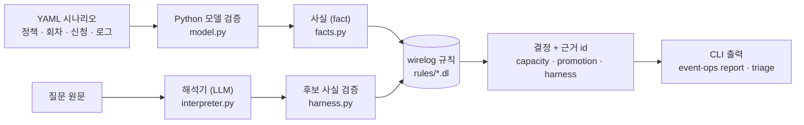

# event-ops-engine — 모임 운영 판단 엔진

*A rules engine for event operations: facts in, Datalog rules, decisions out with evidence ids. The LLM only proposes facts; it never decides.*

반복되는 운영 문의를 **판정**하고, 회차별 신청 현황을 **속성(성별 · 나이 구간)별 목표**와 견주어 홍보가 필요한지 **권고**하는 엔진입니다. 규칙은 [wirelog](https://github.com/semantic-reasoning/wirelog)(Datalog), 입력 변환 · 검증 · 근거 조립은 Python입니다. 엔진은 권고만 하고 실행(홍보 · 신청 처리 · 답변 발송)은 사람이 합니다.

이 저장소에는 **합성 데이터만** 있습니다. 실제 모임 · 고객 · 참가자 정보는 어디에도 없습니다.

## 문제

소규모 모임 운영에서 담당자의 시간을 가장 많이 먹는 일 두 가지입니다.

| 일 | 지금 | 문제 |
|---|---|---|
| "이거 버그인가요?" 문의 | 담당자가 로그를 뒤져서 답한다 | 같은 유형이 반복된다 (계좌 자릿수를 잘못 입력, 문자 발송 timeout인데 실제로는 도착). 매번 사람이 가린다 |
| 회차별 정원 · 성비 · 연령 구성 | 신청 표를 보고 감으로 홍보를 돌린다 | 부족분 · 남은 날 · 추세 · 비율을 한 번에 보는 기준이 없다 |

LLM에게 통째로 맡기면 빠르지만, 근거 없이 "정상입니다"라고 답하는 순간 운영자는 믿을 수 없습니다.

## 접근

**사실 → 규칙 → 근거가 붙은 결정.** 모든 결정에는 어떤 입력 사실(id)에서 나왔는지가 붙습니다.

| 모듈 | 입력 | 규칙이 내는 것 | 결정 |
|---|---|---|---|
| ② 현황 | 회차 · 신청 · 정책(목표) | 속성 값마다 확정 · 대기 · 부족 · 남은 자리 | 현황 표, 확인 요청 |
| ③ 홍보 판단 | ② + 남은 날 · 최근 추세 · 비율 목표 | 부족 · 임박 · 추세 느림 · 불균형 | 홍보 **권고** / **보류** / 확인 요청 |
| ① 문의 판정 | 질문 + 이벤트 로그 | 원인(`cause`) · 더 필요한 사실(`needs`) | `accept` / `ask` / `abstain` / `reject` |
| 직군 정규화 | 신청자의 자유 입력("백엔드 3년차") | 확신도 기준 이상인 후보만 속성으로 | ②에 `job_group` 목표 반영, 미만은 확인 요청 |

LLM은 ①과 직군 정규화에서만 쓰고, 역할은 **후보 사실을 제안**하는 것까지입니다. ①에서는 질문을 후보 사실로, 정규화에서는 자유 입력을 속성 값 후보(값 · 확신도 · 인용)로 바꿉니다. 후보 사실은 관계 네 개만 허용되고, 입력에 없는 id나 질문에 없는 인용이 섞이면 규칙에 닿기 전에 `reject`됩니다. 원인은 규칙만 정하고, 원인이 하나일 때만 `accept`입니다. 설계는 [docs/design.md](docs/design.md), 결정 계약은 그 13절입니다.

## 사용

### 현황과 홍보 판단 (② · ③)

```bash
event-ops report data/synthetic/scenarios/pair-mixed.yaml
```

```
[회차 s2] 정원 12 · 확정 4 · 입금 대기 1 · 남은 자리 7
  age_band=20s: 확정 2 · 대기 0 · 목표 2~12
  age_band=30s: 확정 2 · 대기 0 · 목표 4~12 · 부족 2
  gender=female: 확정 3 · 대기 0 · 목표 6~6 · 부족 3
  gender=male: 확정 1 · 대기 1 · 목표 6~6 · 부족 4
  홍보 권고: 회차 임박: 30s 2명 부족, 홍보가 필요합니다. (이유: lead_time, slow_trend; 근거: session_capacity/s2, days_left/s2, target/s2/age_band/30s, policy/s2/lead_days, ...)
  홍보 권고: 회차 임박: female 3명 부족, 홍보가 필요합니다. (이유: lead_time, slow_trend; 근거: ...)
  홍보 권고: 회차 임박: male 4명 부족, 홍보가 필요합니다. (이유: imbalance, lead_time, slow_trend; 근거: ...)
```

시나리오는 `data/synthetic/scenarios/*.yaml`, 정책(속성 정의 · 목표 · 홍보 기준)은 `policy/events/*.yaml`입니다. 홍보 기준값(`lead_days` 등)은 모두 **가정값**입니다. 입금 대기 중인 자리는 차지한 것으로 보아 남은 자리 · 부족분에서 뺍니다(운영사 규칙). 직군 정규화가 있는 시나리오(`job-group.yaml`)는 기본으로 파일의 `canned_job_groups` 답을 쓰고, `--normalizer claude`를 주면 Claude Code CLI가 자유 입력을 분류합니다.

### 운영 문의 판정 (①)

원인이 하나로 가려지면 `accept`, 근거 로그 id가 붙습니다. 근거는 믿을 수 있는 순서로 나눠 보여 줍니다: 원본 사실(기록된 로그) → 규칙 추론(규칙이 기록에서 끌어낸 사실) → LLM 제안(해석기가 질문에서 뽑아 검증을 통과한 사실).

```bash
event-ops triage data/synthetic/scenarios/triage/account-length.yaml
```

```
[문의 q1] r1 신청자가 입금하려는데 계좌가 없다고 나온대요. 계좌 발급이 잘못됐나요?
  판정: 원인 확정 (accept) · 원인: user_input
  설명: 원인: user_input. 근거: log/e1, log/e2
  근거 · 원본 사실: log/e1, log/e2
  근거 · LLM 제안(검증 통과): candidate/q1/about_registration/r1, candidate/q1/asks_about/payment
  기대 판정: accept · 일치
```

가리기에 사실이 모자라면 `ask`, 무엇이 더 필요한지 말합니다.

```bash
event-ops triage data/synthetic/scenarios/triage/delivery-no-receipt.yaml
```

```
[문의 q1] r1 신청자 안내 문자가 timeout으로 떠요. 다시 보내야 하나요?
  판정: 확인 요청 (ask) · 더 필요한 사실: provider_lookup (외부: 발송 업체 로그)
  설명: 판정하려면 더 필요합니다: provider_lookup (외부: 발송 업체 로그)
  근거 · LLM 제안(검증 통과): candidate/q1/about_event/e1, candidate/q1/asks_about/delivery
  기대 판정: ask · 일치
```

문의 시나리오(`data/synthetic/scenarios/triage/*.yaml`)는 질문 · 이벤트 로그 · 기대 판정을 담습니다. 기본은 파일의 `canned` 해석을 쓰는 가짜 해석기이고, `--interpreter claude`를 주면 Claude Code CLI(`claude -p`, 구독 안에서 추가 비용 없음)가 질문을 후보 사실로 바꿉니다. 기대 판정과 다르면 종료 코드 1, `--trace`로 단계별 기록을 봅니다. `--runs N`은 같은 질문을 N번 판정해 결과 분포와 일치율을 보여 줍니다(실제 해석기의 안정성 확인용). `claude`를 고르면 시작 전에 CLI 로그인을 확인하고, 안 되어 있으면 `claude login` 안내와 함께 종료 코드 2로 멈춥니다. 해석기가 자신 없다고 한 후보 사실(확신도 0.6 미만, 가정값)은 판정에 쓰지 않습니다. 위 출력 예시는 테스트(`tests/test_readme.py`)가 실제 출력과 대조합니다.

## 구조



| 폴더 | 내용 |
|---|---|
| `rules/` | Datalog 규칙: `ontology.dl`(사실 스키마) · `capacity.dl`(②) · `promotion.dl`(③) · `triage.dl`(① 계약 + 유형 1~6 · 2b 규칙) |
| `src/event_ops_engine/` | lib(`model` `bands` `clock` `facts` `policy` `loader` `decision`) · services(`engine` `interpreter` `normalizer`) · features(`capacity` `promotion` `harness` `cli`) |
| `policy/events/` | 모임 정책 YAML 2개 (합성 예시, 기준값은 가정값). `synthetic-job-group.yaml`은 LLM이 정규화하는 `job_group` 차원 예시 |
| `data/synthetic/scenarios/` | 합성 시나리오: 현황 · 홍보 6개(직군 정규화 포함), 문의(`triage/`) 9개 |
| `tests/` | pytest. 계산 로직은 같은 PR에 테스트를 올립니다. README 출력 예시도 테스트합니다 |
| `scripts/` | 엔진 빌드 · wirelog 문법 검증 |
| `docs/` | 설계 · 용어 · 결정 기록 · 공용 기준 사본 |

## 설치

```bash
python3.11 -m venv .venv && source .venv/bin/activate
make install
```

### Intel Mac: 엔진 빌드

2026-10 기준 `pyrewire` wheel에 Intel Mac용 엔진이 없어 한 번 소스 빌드합니다 (약 1~2분).

```bash
pip install meson ninja
make engine            # vendor/wirelog (v0.70.0) 받아서 빌드
```

빌드 결과 `vendor/wirelog/build/libwirelog.1.dylib`는 `WIRELOG_LIB` 환경변수가 비어 있으면 자동으로 잡습니다 (`.env.example` 참고). Linux CI는 wheel에 든 엔진을 그대로 씁니다.

## 개발

```bash
make check     # lint(black · isort · flake8) + typecheck(mypy strict) + test(pytest)
python scripts/verify_wirelog.py   # wirelog 문법 검증 25건 (24건 통과가 정상, docs/design.md 9)
```

브랜치 · 커밋 · PR 규칙과 이 프로젝트에서 다르게 하는 것은 [CONTRIBUTING.md](CONTRIBUTING.md)에 있습니다. 이슈 · PR · 코멘트는 한국어와 영어를 함께 씁니다.

## 읽는 순서

1. 이 README — 문제 · 접근 · 실행
2. [docs/design.md](docs/design.md) — 흐름 · 데이터 모델 · 규칙 · 결정 계약 · wirelog 제약
3. [docs/glossary.md](docs/glossary.md) — 용어 · 상태 값 · 도메인 경계
4. [docs/decisions/](docs/decisions/) — 왜 이렇게 정했는지
5. `rules/*.dl` — 규칙 본문. 각 파일 머리의 주석이 설계 절을 가리킵니다

## 라이선스

Apache-2.0. wirelog는 LGPL-3.0(동적 연결, 저장소에 포함하지 않음), PyreWire는 Apache-2.0 OR GPL-3.0.
